# Guide du client EyeChat pour Windows

Pour l’équipe du cabinet. Les numéros sur les captures indiquent les zones à utiliser.

- [Messagerie et file d’attente](#messagerie-et-file-dattente)
- [Recherche de rendez-vous](#recherche-de-rendez-vous)
- [SMS et mail](#sms-et-mail)
- [Fiche famille](#fiche-famille)

## Messagerie et file d’attente

### Lire les cartes et écrire à l’équipe

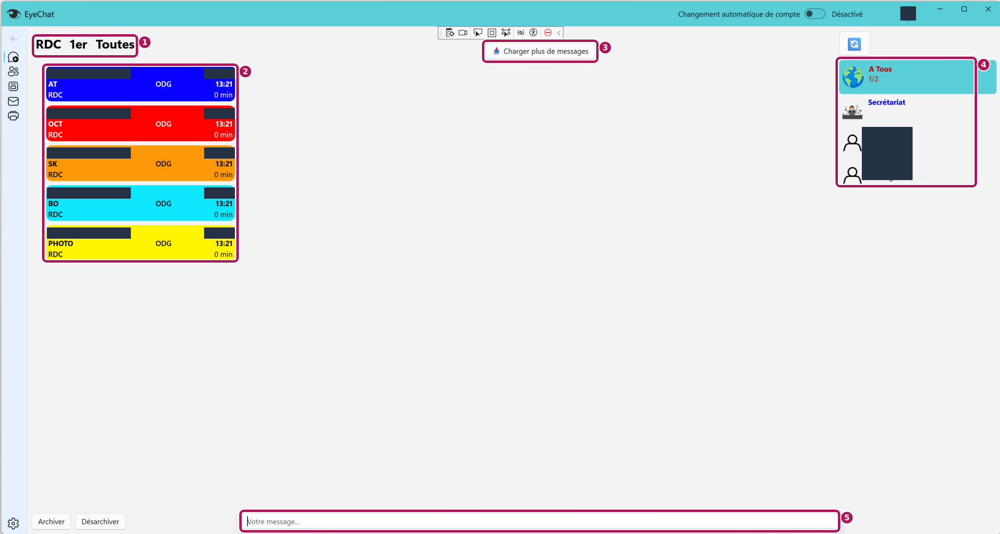

1. Choisissez **RDC**, **1er** ou **Toutes** pour filtrer les cartes.
2. Lisez sur la carte l’examen, l’œil, la salle et le temps écoulé.
3. Cliquez sur **Charger plus de messages** pour consulter les messages précédents.
4. Sélectionnez un destinataire à droite. **A Tous** ouvre la conversation collective.
5. Saisissez votre texte dans **Votre message…** et appuyez sur **Entrée**.

### Agir sur une carte patient

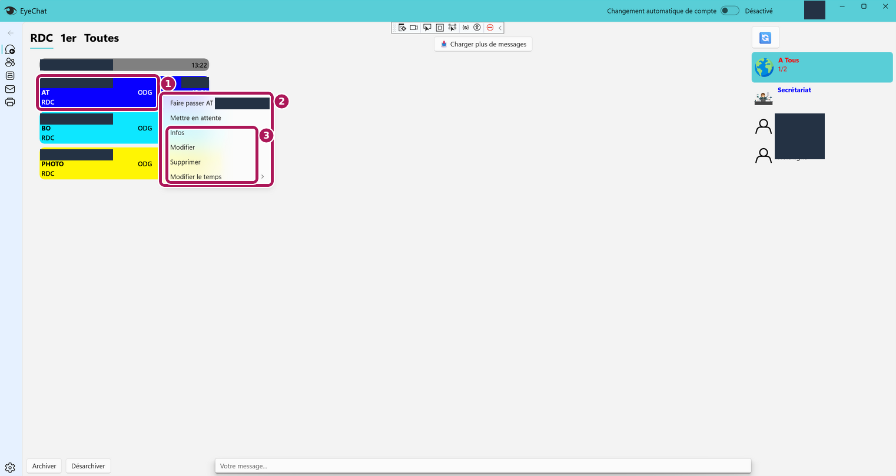

1. Faites un clic droit sur la carte du patient.
2. Choisissez **Faire passer** ou **Mettre en attente** selon l’étape de la prise en charge.
3. Utilisez **Infos** pour consulter la carte, **Modifier** pour la corriger et **Modifier le temps** pour ajuster le temps affiché. Utilisez **Supprimer** si la carte doit être retirée.

### Envoyer un message rapide à un collègue

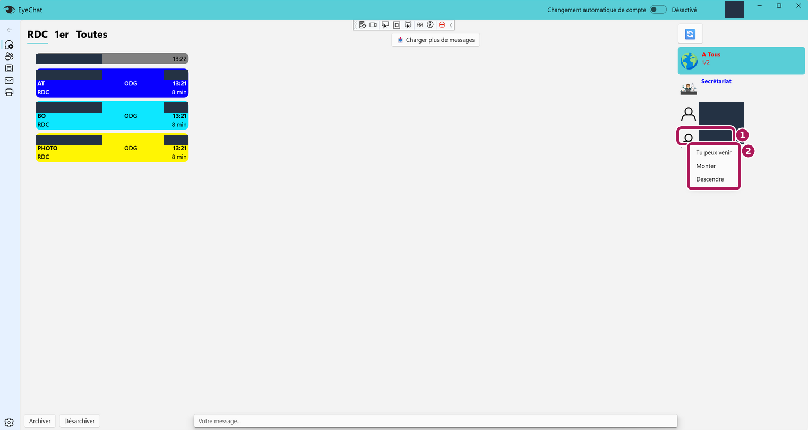

1. Faites un clic droit sur le collègue dans la liste à droite.
2. Choisissez **Tu peux venir**, **Monter** ou **Descendre**.

### Archiver ou désarchiver une carte

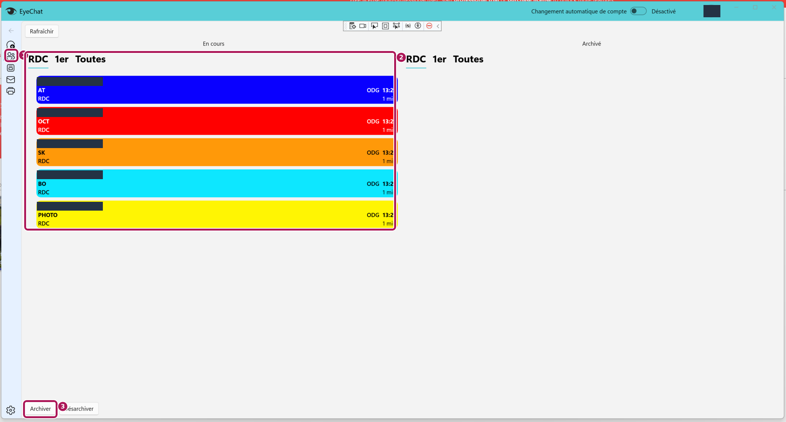

1. Ouvrez la vue de la file avec l’icône **deux personnes**, puis cliquez sur **Rafraîchir** si nécessaire.
2. Dans **En cours**, choisissez un étage et sélectionnez la carte.
3. Cliquez sur **Archiver**.

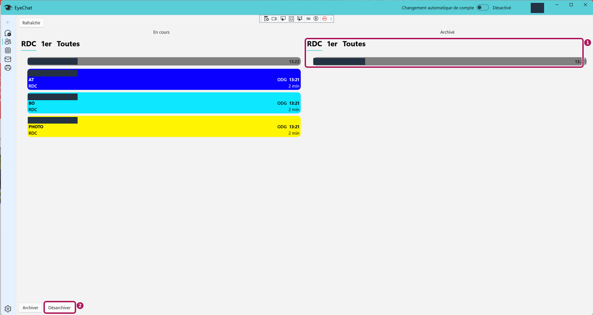

1. Dans **Archivé**, choisissez l’étage correspondant et sélectionnez la carte.
2. Cliquez sur **Désarchiver** pour la remettre dans **En cours**.

### Ajouter un patient

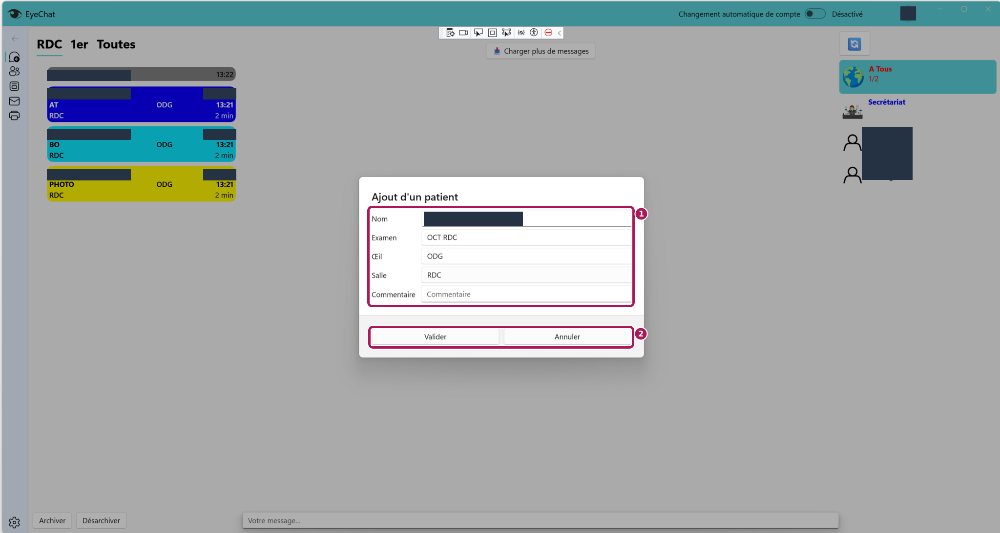

1. Dans **Ajout d’un patient**, renseignez **Nom**, **Examen**, **Œil**, **Salle** et, si besoin, **Commentaire**.
2. Vérifiez la salle et l’œil, puis cliquez sur **Valider**. Cliquez sur **Annuler** pour fermer la fenêtre sans ajouter de carte.

## Recherche de rendez-vous

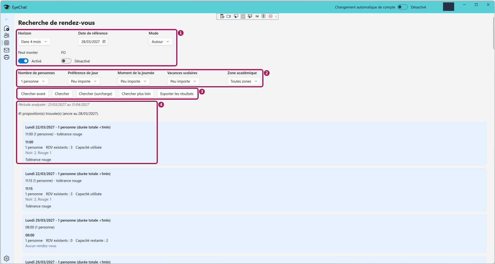

1. Réglez **Horizon**, **Date de référence** et **Mode**, puis vérifiez **Peut monter** et **FO**.
2. Choisissez le **Nombre de personnes** et les préférences de jour, d’horaire ou de vacances scolaires.
3. Cliquez sur **Chercher**. Utilisez **Chercher avant**, **Chercher plus loin** ou **Chercher (surcharge)** selon le besoin. **Exporter les résultats** récupère les propositions.
4. Vérifiez la période analysée et lisez la capacité restante de chaque créneau. Examinez les propositions marquées **Tolérance rouge** avant de les retenir.

## SMS et mail

### Préparer et envoyer les rappels

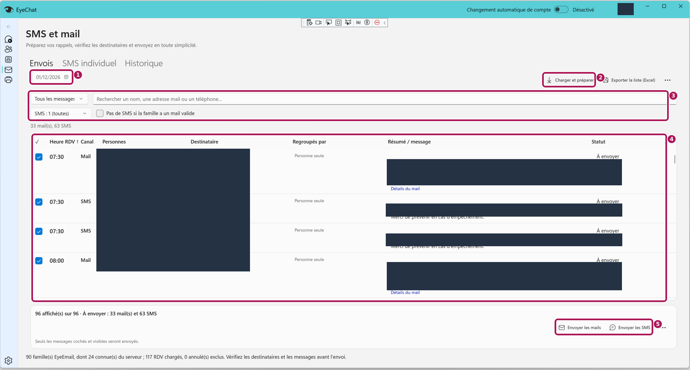

1. Ouvrez **Envois** et choisissez la date des rendez-vous.
2. Cliquez sur **Charger et préparer**.
3. Utilisez les filtres ou la recherche pour retrouver les messages à traiter.
4. Vérifiez l’heure, les personnes, le destinataire et le texte. Pour les rappels groupés, lisez **Regroupés par**. Décochez les lignes à écarter.
5. Vérifiez le compteur et cliquez sur **Envoyer les mails** ou **Envoyer les SMS**. **Seuls les messages cochés et visibles sont envoyés.**

### Envoyer un SMS individuel

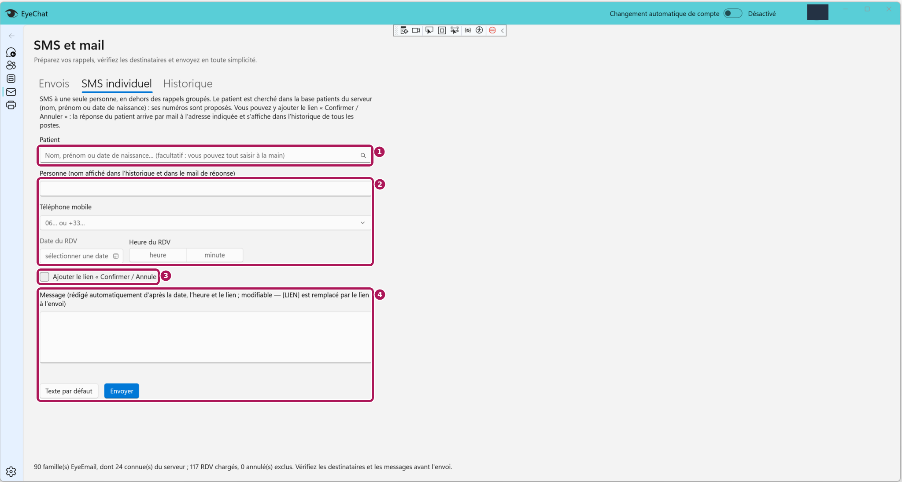

1. Cherchez le patient par nom, prénom ou date de naissance, ou saisissez ses informations à la main.
2. Vérifiez **Personne** et **Téléphone mobile**. Pour un rappel, saisissez la date et l’heure du rendez-vous.
3. Cochez **Ajouter le lien « Confirmer / Annuler »** si vous souhaitez recueillir une réponse.
4. Relisez le message et cliquez sur **Envoyer**. **Texte par défaut** rétablit le texte proposé.

### Consulter l’historique

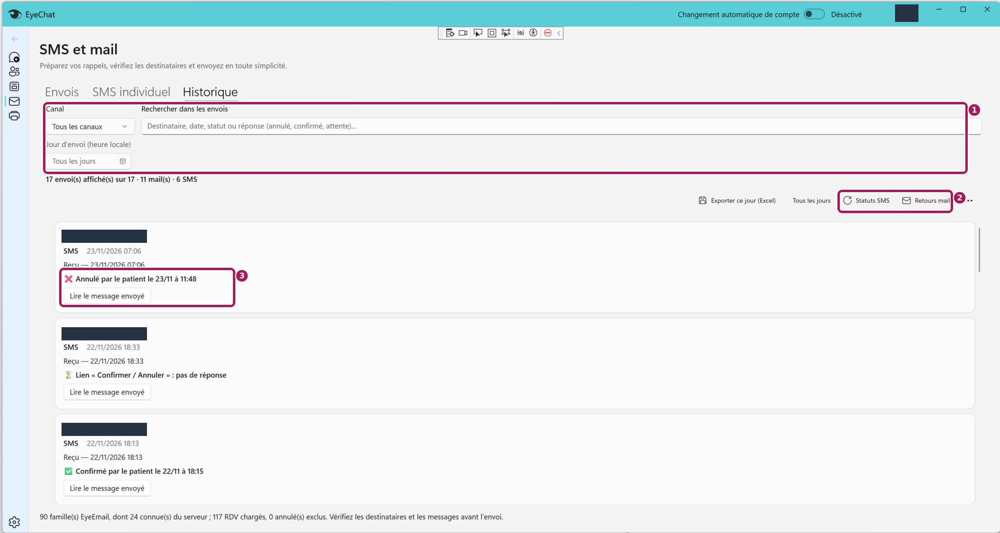

1. Filtrez par **Canal** ou **Jour d’envoi**, ou utilisez **Rechercher dans les envois**.
2. Cliquez sur **Statuts SMS** ou **Retours mail** pour actualiser les informations du canal concerné.
3. Consultez séparément le statut du message, comme **Reçu**, et la réponse du patient, comme **Confirmé**, **Annulé** ou **pas de réponse**. Cliquez sur **Lire le message envoyé** pour retrouver le texte transmis.

## Fiche famille

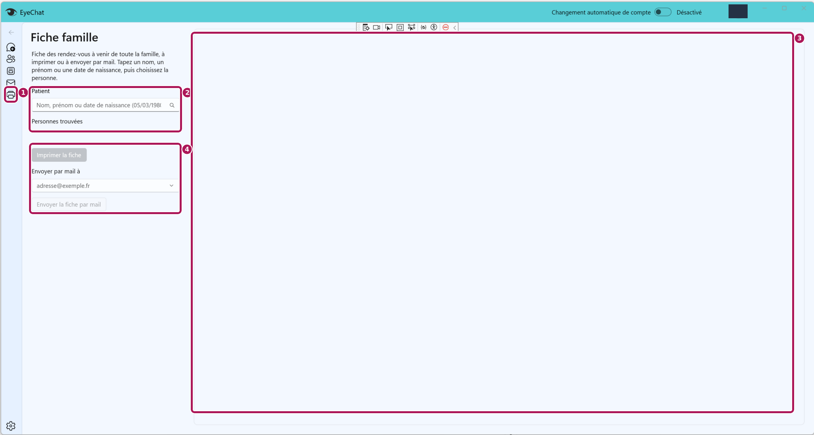

1. Cliquez sur l’icône **imprimante** et recherchez le patient par nom, prénom ou date de naissance.
2. Choisissez la personne sous **Personnes trouvées**.
3. Vérifiez les personnes et les rendez-vous dans l’aperçu. Décochez les personnes à retirer de la fiche.
4. Cliquez sur **Imprimer la fiche**, ou vérifiez l’adresse dans **Envoyer par mail à** avant de cliquer sur **Envoyer la fiche par mail**.
